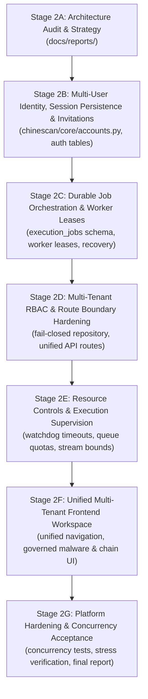

# ChiNeScan — Phase 2 Implementation Plan: Multi-User Web Platform & Robust Orchestration

**Document:** `docs/reports/phase-2-implementation-plan.md`
**Date:** 2026-11-24
**Repository:** `C:\GitHub\Chinescan`
**Current Branch:** `main`
**Baseline Commit:** `c09d3f150003421136790c42ffa96d570606da79`
**Status:** Implementation plan proposed for review

---

## 1. Architectural Principles and Invariants

This plan defines the concrete roadmap to transition ChineScan from a hybrid single-operator tool into a dependable, multi-user, multi-tenant security operations platform.

### Architectural Invariants:
1. **SQLite & Single-Instance Baseline:** The persistence architecture remains single-instance SQLite with WAL mode, foreign key enforcement (`PRAGMA foreign_keys=ON`), and serialized transaction blocks (`BEGIN IMMEDIATE`). No Redis, PostgreSQL, RabbitMQ, or Kubernetes clusters will be introduced.
2. **Preserve Phase 1 Foundations:** Phase 1 governance controls (immutable execution context, centralized policy admission, one-use human approvals consumed at action boundaries, execution result provenance, and adapter contracts) are working and verified. They must **not be rebuilt, replaced, or duplicated**.
3. **Fail-Closed Security Default:** Tenant isolation and access control must be strictly fail-closed. If an organization or engagement context is omitted, access must be denied (`403 Forbidden` or `404 Not Found`), never fallback to cross-tenant exposure.
4. **Zero Unsafe Replays:** Jobs that crash, terminate, or lose worker ownership while running must never be blindly re-executed if they might have performed external operations or consumed one-use approvals.
5. **Secret Hygiene:** Passwords, tokens, and TOTP recovery secrets must be hashed using Argon2id. Secrets must never be logged, written to default config files, or serialized into client responses.
6. **Isolation of Unrelated Work:** ARTEX integration work and cover artwork scripts remain excluded from Phase 2 commits.

---

## 2. Stage Breakdown and Roadmap

Phase 2 is partitioned into seven sequential stages, each with defined file boundaries, database migration needs, security invariants, and acceptance criteria.



---

## 3. Stage Specifications

### Stage 2A: Architecture Audit & Implementation Strategy (Current Stage)
- **Objective:** Complete read-only audit of current codebase against multi-user platform requirements and publish strategic documentation.
- **Scope:** Read-only inspection; documentation generation only.
- **Deliverables:**
  - `docs/reports/phase-2-architecture-audit.md`
  - `docs/reports/phase-2-implementation-plan.md`
- **Dependencies:** None.

---

### Stage 2B: Multi-User Identity, Session Persistence & Invitation Onboarding
- **Objective:** Enable multi-user authentication backed by persistent SQLite storage, replacing volatile in-memory sessions and single-operator credential files.
- **Scope & Changes:**
  1. **New Database Migration (`0014_user_credentials_and_sessions.py`):**
     - Table `user_credentials`: `(user_id PK FK users.id, password_hash VARCHAR, totp_secret VARCHAR NULL, totp_recovery_hashes JSON NULL, failed_attempts INTEGER, locked_until DATETIME NULL, updated_at DATETIME)`.
     - Table `user_sessions`: `(token_hash VARCHAR PK, user_id VARCHAR FK users.id, csrf_token VARCHAR, expires_at DATETIME, idle_expires_at DATETIME, ip_address VARCHAR NULL, user_agent VARCHAR NULL, created_at DATETIME)`.
     - Table `user_invitations`: `(id VARCHAR PK, organization_id VARCHAR FK organizations.id, email_normalized VARCHAR, role VARCHAR, token_hash VARCHAR, inviter_user_id VARCHAR FK users.id, expires_at DATETIME, accepted_at DATETIME NULL, created_at DATETIME)`.
     - Table `password_reset_tokens`: `(token_hash VARCHAR PK, user_id VARCHAR FK users.id, expires_at DATETIME, used_at DATETIME NULL, created_at DATETIME)`.
  2. **Core Services (`chinescan/core/accounts.py`, `chinescan/core/organizations.py`):**
     - Migrate single-operator credential migration: on startup, if `operator.json` exists, migrate credentials to `user_credentials` table in SQLite, preserving the operator's identity and Argon2id hash.
     - Implement database-backed `PersistentSessionStore` with atomic cleanup and idle timeout.
     - Implement `InvitationService` in `chinescan/core/organizations.py`: create invitation, validate invitation token, accept invitation and initialize user account.
  3. **Web API (`chinescan/web/auth.py`, `chinescan/web/app.py`, `chinescan/web/organization_api.py`):**
     - Update `/api/auth/login`: authenticate against `user_credentials` for any active user.
     - Add `/api/auth/invitations/{token}` (public endpoint to check invitation validity).
     - Add `/api/auth/accept-invitation` (create password, consume invitation token, establish session).
     - Update `/api/organizations/{org_id}/invitations` (admin/owner invites email address).
     - Update `current_session` dependency to read from `user_sessions` table.
- **Security Invariants:**
  - Password hashes must use Argon2id with salt.
  - Invitation tokens and reset tokens must use 32-byte cryptographic entropy, stored exclusively as SHA-256 digests.
  - Accepting an invitation must be atomic and invalidate the invitation token.
  - Demoting, suspending, or deleting a user immediately revokes all their active sessions.
- **Acceptance Tests:**
  - `test_database_credential_migration_from_operator_json`: Operator creds migrated seamlessly on startup.
  - `test_multi_user_login_and_session_persistence`: Server restart preserves active sessions in SQLite.
  - `test_invitation_lifecycle`: Owner invites email -> invited user registers with password -> user added to org memberships.
  - `test_invitation_expiry_and_replay`: Expired or reused invitation tokens return 400/409.
  - `test_session_revocation_on_password_reset`: Changing password revokes all active sessions for that user.

---

### Stage 2C: Durable Job Orchestration, Worker Leases & Interrupted Job Recovery
- **Objective:** Transform the governed execution worker into a robust, lease-backed queue system that reliably recovers from crashes, prevents stuck jobs, and supports standalone execution.
- **Scope & Changes:**
  1. **New Database Migration (`0015_durable_execution_leases.py`):**
     - Update `execution_jobs`:
       - Add `worker_id VARCHAR(64) NULL`
       - Add `lease_expires_at DATETIME NULL`
       - Add `heartbeat_at DATETIME NULL`
       - Add `retry_count INTEGER NOT NULL DEFAULT 0`
       - Add `max_retries INTEGER NOT NULL DEFAULT 0`
       - Add index on `(status, lease_expires_at)`
  2. **Core Governance (`chinescan/core/execution_governance.py`):**
     - Implement atomic lease claiming:
       ```sql
       UPDATE execution_jobs
       SET status = 'claimed', worker_id = :worker_id, lease_expires_at = :lease_expiry, heartbeat_at = :now
       WHERE id = (
           SELECT id FROM execution_jobs
           WHERE status = 'queued' OR (status = 'running' AND lease_expires_at < :now)
           ORDER BY created_at ASC LIMIT 1
       )
       ```
     - Implement periodic worker heartbeat thread that extends `lease_expires_at` while the job is actively executing.
     - Implement stale-job reconciler:
       - If a job lease expires and `approval_consumed_at` is NOT set, check retry policy. If retries exhausted or unrecoverable, mark `failed` (`LEASE_EXPIRED`).
       - If `approval_consumed_at` IS set, **never automatically replay** the job (violates one-use approval invariant); mark `failed` (`INTERRUPTED_AFTER_APPROVAL_CONSUMPTION`).
     - Decouple in-memory cancellation: workers periodically check `execution_jobs.cancellation_requested_at` in SQLite at safe execution checkpoints, eliminating reliance on process-local `threading.Event`.
  3. **Standalone Worker Runner (`chinescan/cli/commands.py`):**
     - Add CLI command `chinescan worker run [--concurrency N] [--lease-seconds S]`.
     - Allows running the worker as an independent OS service or background daemon separate from the FastAPI web server.
- **Security Invariants:**
  - Two workers cannot claim or execute the same job simultaneously.
  - A job with a consumed one-use approval must never be auto-retried.
  - Worker lease expiry must be safely longer than the heartbeat period (e.g. 30s lease, 5s heartbeat).
  - Terminal states (`completed`, `failed`, `cancelled`, `blocked`) are strictly immutable.
- **Acceptance Tests:**
  - `test_atomic_worker_claiming_concurrency`: Concurrent workers attempting to claim the same queue never claim the same job.
  - `test_heartbeat_lease_extension`: Long-running job continually extends lease.
  - `test_expired_lease_recovery_without_approval`: Abandoned unapproved job is reconciled as failed or retried.
  - `test_expired_lease_safety_with_approval`: Abandoned job with consumed approval is marked failed, never silently replayed.
  - `test_database_driven_cancellation_across_processes`: Setting cancellation in web process halts standalone worker at next checkpoint.

---

### Stage 2D: Multi-Tenant RBAC Enforcement & Route Boundary Hardening
- **Objective:** Eliminate tenant isolation gaps, enforce fail-closed repository filtering, and unify API routes for team access.
- **Scope & Changes:**
  1. **Strict Fail-Closed Storage (`chinescan/core/storage/sqlite.py`):**
     - Modify `_owned_record()`: If `_current_organization_id()` and `worker_organization_id` are both `None`, raise `TenantContextRequiredError` rather than returning `None`.
     - Explicit admin bypass only for system maintenance routines (`@contextmanager system_context()`).
  2. **API Route Modernization (`chinescan/web/app.py`):**
     - Remove the hardcoded `operator_only_prefixes` restriction that blocked non-operator users from accessing scans, findings, cases, and reports.
     - Scope all scan, finding, and report queries to the user's active organization header (`X-Chinescan-Organization-Id`) or personal organization.
     - Verify organization membership before serving any scan or report download (`/api/scans/{scan_id}/report/{format}`).
  3. **Engagement Route Consistency:**
     - Ensure all routes in `organization_router`, `engagement_security_router`, `execution_router`, `log_evidence_router`, and `repository_router` establish `with repository.organization_context(org_id):` during execution.
- **Security Invariants:**
  - Calling `repository.get()`, `page_records()`, or `list_records()` without an active tenant context must fail closed.
  - An organization member cannot read, update, or download records, evidence, or reports belonging to another organization.
  - Users with `viewer` or `observer` roles can never trigger execution jobs, add assets, or approve requests.
- **Acceptance Tests:**
  - `test_repository_fails_closed_without_tenant_context`: Direct query without context raises error.
  - `test_cross_organization_scan_isolation`: User in Org A cannot fetch scans, findings, or reports created in Org B.
  - `test_member_report_download`: Non-operator team member in Org A can download reports for Org A's scans.
  - `test_role_enforcement_on_mutations`: `viewer` role rejected with 403 on asset creation, scope publication, or job submission.

---

### Stage 2E: Resource Controls, Quota Management & Execution Supervision
- **Objective:** Prevent server resource exhaustion and protect against denial-of-service from large inputs, hanging parsers, or runaway jobs.
- **Scope & Changes:**
  1. **Watchdog Execution Timer (`chinescan/core/execution_adapters.py`):**
     - Implement a preemptive watchdog timer for adapter execution: if an adapter does not complete or yield within `job_deadline_seconds`, the watchdog triggers a cancellation interrupt.
  2. **Per-Organization Concurrency and Storage Quotas:**
     - Enforce maximum active concurrent executions per organization (configurable, default 2).
     - Track and enforce total snapshot storage per organization across repository, log, and malware evidence.
  3. **Bounded Subprocess Streaming:**
     - Ensure external tool adapters read stdout/stderr using fixed-size chunk buffers (`MAX_SUBPROCESS_OUTPUT_BYTES = 50 MB`) to prevent memory exhaustion from verbose scanner output.
- **Security Invariants:**
  - A hanging file scan or log parse cannot block worker threads beyond `job_deadline_seconds`.
  - Storage quotas cannot be bypassed by submitting concurrent evidence uploads.
- **Acceptance Tests:**
  - `test_watchdog_timeout_aborts_hanging_scan`: Simulated infinite loop in file parser is terminated by watchdog.
  - `test_organization_concurrency_quota`: Submitting jobs beyond org concurrency limit returns 429 Queue Full.
  - `test_subprocess_output_truncation`: Huge scanner stdout is safely capped without memory blowout.

---

### Stage 2F: Unified Multi-Tenant Frontend Workspace & Real-Time Job Monitoring
- **Objective:** Eliminate the dual-track UI disconnect, provide full engagement workflow coverage, and deliver responsive job monitoring.
- **Scope & Changes:**
  1. **Unified Workspace Navigation (`frontend/src/ui/App.tsx`):**
     - Add an organization/engagement switcher in the top navigation bar.
     - Repurpose the sidebar navigation (`Scans`, `Findings`, `Cases`, `Code assessments`, `Log analysis`, `Malware triage`, `On-chain tracing`) to display data scoped to the currently selected organization and engagement.
     - Display clear permission indicators reflecting the user's role in the active organization.
  2. **Complete Governed Feature Workspaces:**
     - Build and mount `GovernedMalwareWorkspace.tsx` inside the engagement view to manage sample intake, static triage, and evidence provenance.
     - Build and mount `GovernedChainTraceWorkspace.tsx` for governed on-chain import and provider executions.
  3. **Invitation and Member Management UI (`frontend/src/ui/OrganizationsWorkspace.tsx`):**
     - Replace raw UUID input with an "Invite Member" modal accepting email and role.
     - Add "Pending Invitations" list with revocation capabilities.
  4. **Efficient Status Synchronization:**
     - Replace the 1.5s multi-job polling timer with a lightweight `/api/organizations/{org_id}/engagements/{eng_id}/executions/active` status endpoint or Server-Sent Events (SSE) feed.
- **Security Invariants:**
  - Frontend navigation strictly respects backend RBAC responses.
  - UI never displays action controls for actions forbidden by the user's role.
- **Acceptance Tests:**
  - Frontend component tests verifying invitation dialog, role-based button disabling, and active job status rendering.

---

### Stage 2G: Platform Hardening, End-to-End Concurrency Testing & Acceptance Verification
- **Objective:** Final verification under multi-user concurrency, stress testing, and acceptance reporting.
- **Scope & Changes:**
  1. **Concurrency Test Suite:**
     - Multi-threaded worker claim race tests (5+ concurrent worker threads claiming 50 queued jobs).
     - Simultaneous approval consumption and policy revalidation under concurrent load.
     - Process restart simulation under active job load.
  2. **Documentation & Operational Manual:**
     - Document CLI commands for running standalone workers, managing users, and monitoring queue health.
     - Record final acceptance findings in `docs/reports/phase-2-report.md`.
- **Security Invariants:**
  - Zero lost updates, zero double-claims, zero double-consumptions of one-use approvals.
  - Clean `git status` with preserved ARTEX isolation.
- **Acceptance Tests:**
  - Full Python test suite (`py -3.12 -m pytest`) passing 100%.
  - Mypy type-checking clean across all modified modules.

---

## 4. Dependencies Between Stages

```
Stage 2A (Audit)
  └── Stage 2B (Multi-User Identity & Sessions)
        ├── Stage 2C (Durable Job Orchestration & Worker Leases)
        │     └── Stage 2E (Resource Controls & Execution Supervision)
        └── Stage 2D (Multi-Tenant RBAC & Route Boundary Hardening)
              ├── Stage 2F (Unified Multi-Tenant Frontend Workspace)
              └── Stage 2G (Platform Hardening & Acceptance Verification)
```

- **Stage 2B** is the prerequisite for all subsequent runtime changes because user sessions, credentials, and tenant identities must be established in the database before routes can be unified.
- **Stage 2C** can proceed in parallel with **Stage 2D** once Stage 2B is in place.
- **Stage 2E** builds upon Stage 2C's worker lease and watchdog structure.
- **Stage 2F** depends on Stage 2D's unified API routes.
- **Stage 2G** verifies the integrated system.

---

## 5. Mandatory Work vs. Optional Future Enhancements

### Mandatory Scope for Phase 2:
- Database-backed user credentials and persistent sessions.
- Invitation-only user onboarding with tokenized email/link workflow.
- Database-backed worker leases, heartbeat extension, and crash recovery.
- Strict fail-closed tenant scoping in `SQLiteRepository`.
- Unification of scan, finding, case, and report API routes for multi-user access.
- Preemptive watchdog execution timeout in adapters.
- Unified frontend organization switcher and governed workspace UI.
- Comprehensive concurrency tests proving multi-worker safety under SQLite.

### Explicitly Excluded (Deferred to Future Milestones):
- Remote multi-host clustering, PostgreSQL migration, or Redis queues (unnecessary and violates single-instance baseline).
- Live active network exploitation or vulnerability scanning (violates static/posture-only charter).
- Automated external malware detonation or dynamic analysis.
- Third-party SSO / SAML / OIDC integration (can be added cleanly in a later stage once local multi-user auth is proven).

---

## 6. Phase 1 Preservation Checklist

During all Phase 2 implementation stages, the following Phase 1 contracts must remain inviolate:
- [x] Immutable `ExecutionContext` with SHA-256 digest calculation.
- [x] Centralized policy check (`ALLOW` / `DENY` / `REQUIRE_APPROVAL`).
- [x] One-use approvals consumed atomically at external action boundaries, never at job admission.
- [x] Execution result provenance linking all created records.
- [x] Complete isolation of unrelated ARTEX integration code and cover artwork scripts.
- [x] Zero production database modifications or destructive schema alterations.
